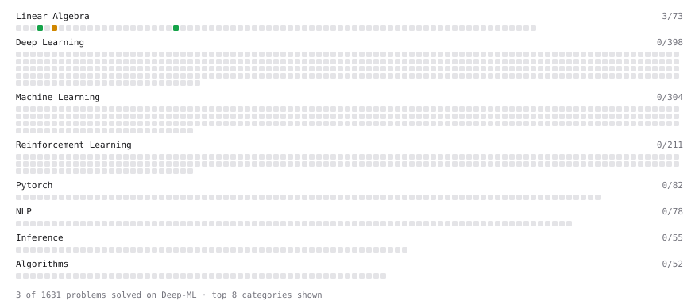

# Deep-ML

My machine learning practice from [Deep-ML](https://www.deep-ml.com). Every solution here was written by hand.

**8** solved · 4 problems · 0 labs · 4 math

[**Browse the interactive portfolio**](https://amanvermaav992.github.io/deep-ml/) to replay this filling in over time.

## Problems

| | Difficulty | Solved | |
| --- | --- | --- | --- |
| [Calculate Mean by Row or Column](https://www.deep-ml.com/problems/4) | easy | 2026-10-19 | [solution](problems/0004-calculate-mean-by-row-or-column) |
| [Implement Orthogonal Projection of a Vector onto a Line](https://www.deep-ml.com/problems/66) | easy | 2026-10-20 | [solution](problems/0066-implement-orthogonal-projection-of-a-vector-onto-a-line) |
| [Linear Regression Using Normal Equation](https://www.deep-ml.com/problems/14) | easy | 2026-10-25 | [solution](problems/0014-linear-regression-using-normal-equation) |
| [Calculate Eigenvalues of a Matrix](https://www.deep-ml.com/problems/6) | medium | 2026-10-19 | [solution](problems/0006-calculate-eigenvalues-of-a-matrix) |

## Math

| | Difficulty | Solved | |
| --- | --- | --- | --- |
| [Inverse and Rank](https://www.deep-ml.com/math-problems/12) | medium | 2026-10-19 | [solution](math/0012-inverse-and-rank) |
| [Least Squares and the Normal Equations](https://www.deep-ml.com/math-problems/34) | medium | 2026-10-20 | [solution](math/0034-least-squares-and-the-normal-equations) |
| [Orthogonality and Projections](https://www.deep-ml.com/math-problems/14) | medium | 2026-10-19 | [solution](math/0014-orthogonality-and-projections) |
| [Solving Linear Systems](https://www.deep-ml.com/math-problems/13) | medium | 2026-10-25 | [solution](math/0013-solving-linear-systems) |

---

_This file is regenerated by Deep-ML on every push._
